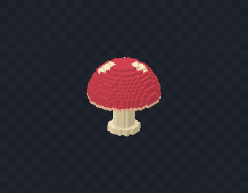

# Slice Atelier

Live 3D slice preview for Aseprite. Draw on regular layers and inspect your pixel art as a rotatable volume.

Asepriteのレイヤーを立体の断面として重ね、描きながらポップアップで確認する拡張です。
通常のキャンバスで描画・消しゴム・レイヤー操作・Undoを行うと、プレビューに自動反映します。
ゲームエンジンとの連携は含めていません。



## インストール

1. [Releases](https://github.com/Ayanoyos/SliceAtelier/releases) から `SliceAtelier-0.1.0.aseprite-extension` をダウンロードし、ダブルクリックします。
   または Aseprite の **Edit → Preferences → Extensions → Add Extension** から選択します。
2. Asepriteを再起動します。
3. **View → Slice Atelier: Live 3D Preview** を選びます。

このリポジトリの [`dist/`](dist/) にもインストール用ファイルを同梱しています。

動作確認環境: Windows / Steam版 Aseprite **1.3.18.6**。
まずはこのバージョン向けの試作です。UIの操作名は英語です。

## まず試す

プレビューの **New demo** を押すと、断面24枚のキノコを新しい未保存ドキュメントに作ります。
いま開いている作品には書き込みません。

プレビューのタイトルバーをドラッグして、描画キャンバスの横へ移動してください。
通常のキャンバスでレイヤーを選び、描く・消す・移動する・並べ替える操作を試せます。
更新は約0.18秒間隔です。描画中の仮表示ではなく、基本的にはストローク確定後の画素を反映します。

## 自分で作る

1. まずは **32×32 px** の透過キャンバスを作ります。
2. レイヤー1枚につき、立体の断面1枚を描きます。
3. レイヤーを追加し、隣の断面を複製・修正して形をつなげます。
4. プレビューを回して、形を確認します。
5. 作品は通常どおり **.aseprite** で保存します。断面用PNGを別に作る必要はありません。

**Horizontal slices (Y)** は床と平行な断面を下から上へ積みます。
レイヤーパネルのいちばん下が立体のいちばん下、キャンバスの横方向がX、縦方向がZです。
画面の上に描いた画素は立体の奥側になります。

**Front-facing slices (Z)** は正面から見た絵を奥から手前へ重ねます。
レイヤーパネルのいちばん下がいちばん奥、キャンバスの横方向がX、縦方向がYです。
通常のイラストのパーツを奥行き方向にずらして見たい場合はこちらを選びます。

## プレビューの操作

| 操作・項目 | 内容 |
| --- | --- |
| 左ドラッグ | 左右の回転・上下の傾き |
| Shift＋ドラッグ / 右・中ドラッグ | 表示位置の移動 |
| ホイール | 拡大・縮小 |
| ダブルクリック / 3D | 標準の視点・倍率へ戻す |
| Top / Front | 真上・正面から確認 |
| Fit | 回転角を保ち、倍率と表示位置を戻す |
| Thickness % | 断面の厚さ。100%で1画素と同じ厚さ |
| Explode % | 断面の間に隙間を空け、層を分離して確認 |
| Include hidden | 非表示レイヤーも立体に含める |
| Shading | 面の向きに応じた簡易的な明暗 |
| Highlight layer | 現在選んでいるレイヤーを黄色寄りに強調 |
| Refresh | 手動でレイヤーを読み直す |

## データの扱い・制限

- 通常の画像レイヤーが対象です。グループ内の画像レイヤーは下から順に展開します。タイルマップは対象外です。
- 空レイヤー・現在フレームが空のレイヤー・非表示レイヤーにも断面の位置があり、消して詰め直しません。
- 複数フレームでは、選択中のフレームを表示します。別の作品へ切り替えるとプレビューも追従します。
- RGB / グレースケール / インデックスカラーに対応します。
- 画素のアルファとセル・レイヤーの不透明度を掛け合わせ、**128以上を立体、128未満を空白**として表示します。半透明の再現や、レイヤーの合成モードは対象外です。
- 断面の画素を小さな直方体として描画します。画像面をそのまま積んだときに生じる、横から見た隙間を防ぎます。
- 表示は正投影です。遠近法・自由歩行・ゲームへの書き出しはこの試作の範囲外です。
- CPUで描画するため、最大256レイヤー、走査対象約419万画素、立体画素10万個に制限しています。初回は32×32 px、16〜32枚程度がおすすめです。
- プレビューを開く操作自体は元の作品を変更しません。ポップアップを閉じるとタイマーとイベント監視を解除します。

## 開発・検証

`extension/` が拡張のソースです。外部ライブラリは不要です。

```powershell
./tools/test.ps1
./tools/build.ps1
```

テストは実際のAsepriteをバッチ起動し、重なりの前後関係、断面の軸、レイヤーの可視性、画素の位置、Undo、フレーム、パレット変更を検証します。
`artifacts/test-results.txt` に結果を保存し、`artifacts/mushroom.aseprite` とプレビューPNGを生成します。

別の実行ファイルを使う場合:

```powershell
./tools/test.ps1 -Aseprite 'C:/path/to/Aseprite.exe'
```

公式API: [Dialog](https://aseprite.org/api/dialog)、[Sprite](https://aseprite.org/api/sprite)、[拡張の導入](https://aseprite.org/docs/extensions/)。

## ライセンス

[MIT License](LICENSE)
